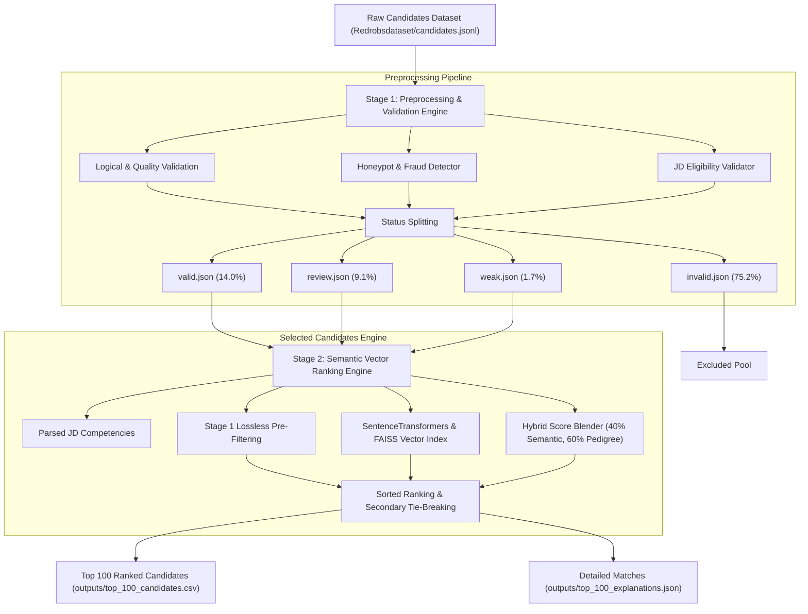

# End-to-End Candidate Discovery, Validation, & Ranking Pipeline

This repository contains the end-to-end automated platform designed for the **Redrob Intelligent Candidate Discovery & Ranking Challenge**. The system filters out fraudulent/unqualified candidate profiles from a dataset of 100,000 records, evaluates viability against a Senior AI Engineer (Ranking & Retrieval) Job Description, and ranks the candidates using a hybrid multi-factor vector model to deliver the top 100 fits.

---

## 📐 System Architecture Workflow

The framework operates as a **two-stage cascaded architecture**:



---

## 📁 Repository Structure

*   [Redrobsdataset/](file:///c:/Users/rg975/OneDrive%20-%20Vidyalankar%20Institute%20of%20Technology/23101A0019%20Rohit%20Gupta%20INFT-A/redrobs/Redrobsdataset/): Workspace folder containing the raw source candidates dataset (`candidates.jsonl`), job description documents, and submission validators.
*   [Preprocessing pipeline/](file:///c:/Users/rg975/OneDrive%20-%20Vidyalankar%20Institute%20of%20Technology/23101A0019%20Rohit%20Gupta%20INFT-A/redrobs/Preprocessing%20pipeline/): Stage 1 data validation system. Responsible for filtering missing schemas, chronology conflicts, skill inflation, and honeypot indicators. Outlines statistics inside `Preprocessing pipeline/output/validation_report.json`.
*   [SelectedCandidates/](file:///c:/Users/rg975/OneDrive%20-%20Vidyalankar%20Institute%20of%20Technology/23101A0019%20Rohit%20Gupta%20INFT-A/redrobs/SelectedCandidates/): Stage 2 semantic vector indexing, FAISS retrieval engine, and hybrid scoring blender.
*   [configs/config.py](file:///c:/Users/rg975/OneDrive%20-%20Vidyalankar%20Institute%20of%20Technology/23101A0019%20Rohit%20Gupta%20INFT-A/redrobs/configs/config.py): Shared settings (AI keywords, required competencies, target locations, consulting companies).
*   [validators/](file:///c:/Users/rg975/OneDrive%20-%20Vidyalankar%20Institute%20of%20Technology/23101A0019%20Rohit%20Gupta%20INFT-A/redrobs/validators/): Validation modules imported across preprocess and ranking steps.
*   [scoring/](file:///c:/Users/rg975/OneDrive%20-%20Vidyalankar%20Institute%20of%20Technology/23101A0019%20Rohit%20Gupta%20INFT-A/redrobs/scoring/): Synthesis scoring logic.

---

## ⚡ Execution Roadmap

Follow these two sequential steps to compile data and generate candidate selections:

### Step 1: Preprocess Candidate Records
Executes data validators on 100,000 candidates to split them into clean lists.
1.  Navigate to the preprocessing folder:
    ```bash
    cd "Preprocessing pipeline"
    ```
2.  Run the validation container:
    ```powershell
    .\docker_build_run.ps1
    ```
    *Output splits will be saved under `Preprocessing pipeline/output/`.*

### Step 2: Rank Candidates & Select Top 100
Ingests preprocessed VALID/REVIEW/WEAK splits, executes semantic vector indexing, scores credentials, and ranks the candidates.
1.  Navigate to the selection folder:
    ```bash
    cd "SelectedCandidates"
    ```
2.  Build the ranking docker container:
    ```bash
    make docker-build
    ```
3.  Execute ranking:
    ```bash
    make docker-run
    ```
    *Top 100 CSV outputs are written back to `SelectedCandidates/outputs/top_100_candidates.csv` and report analytics plots are stored under `SelectedCandidates/reports/`.*

---

## 📜 Compliance and Verification

All output ranked results are deterministically sorted and automatically verified on completion using `Redrobsdataset/validate_submission.py`. Detailed system logic reports and anti-fraud indicators can be found inside:
*   [SelectedCandidates/reports/reportlogic.md](file:///c:/Users/rg975/OneDrive%20-%20Vidyalankar%20Institute%20of%20Technology/23101A0019%20Rohit%20Gupta%20INFT-A/redrobs/SelectedCandidates/reports/reportlogic.md) (Flowchart & scoring formulas)
*   [SelectedCandidates/reports/honeypot_report.md](file:///c:/Users/rg975/OneDrive%20-%20Vidyalankar%20Institute%20of%20Technology/23101A0019%20Rohit%20Gupta%20INFT-A/redrobs/SelectedCandidates/reports/honeypot_report.md) (Honeypot audits and validator rules)
