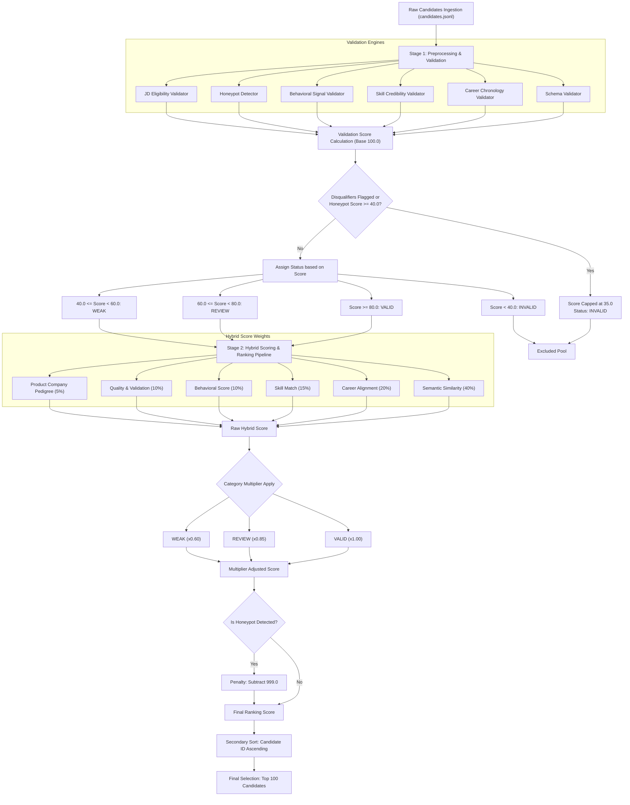

# Candidate Evaluation & Ranking Pipeline Logic Framework

This document outlines the detailed scoring logic, behavioral signals, honeypot detection mechanisms, and the hybrid selection model used by the **Redrob Intelligent Candidate Discovery & Ranking Pipeline** to process candidate profiles and rank the Top 100.

---

## 1. Pipeline Architecture Flowchart

Below is the visual workflow detailing candidate state transitions from ingestion, through Stage 1 preprocessing and validation, to Stage 2 hybrid scoring and final ranking:

---

## 2. Stage 1: Preprocessing & Candidate Classification

In the preprocessing phase, each candidate's data is verified across multiple layers. A candidate starts with a **base validation score of 100.0**, from which deductions are subtracted based on the severity of issues found.

The preprocessing logic is implemented inside [preprocess.py](file:///c:/Users/rg975/OneDrive%20-%20Vidyalankar%20Institute%20of%20Technology/23101A0019%20Rohit%20Gupta%20INFT-A/redrobs/Preprocessing%20pipeline/preprocess.py) and scoring is governed by [validation_score.py](file:///c:/Users/rg975/OneDrive%20-%20Vidyalankar%20Institute%20of%20Technology/23101A0019%20Rohit%20Gupta%20INFT-A/redrobs/Preprocessing%20pipeline/scoring/validation_score.py).

### 2.1 Deductions & Penalties Table

| Category | Issue / Flag | Deduction Per Incident | Cap Limit | File Source |
| :--- | :--- | :--- | :--- | :--- |
| **Schema Quality** | High severity schema errors (e.g. missing vital sections or malformed IDs) | 30.0 points | Max 40.0 points | [schema_validator.py](file:///c:/Users/rg975/OneDrive%20-%20Vidyalankar%20Institute%20of%20Technology/23101A0019%20Rohit%20Gupta%20INFT-A/redrobs/validators/schema_validator.py) |
| | Medium severity schema errors (e.g. missing profile field) | 10.0 points | | |
| **Career Consistency**| Future start/end dates, invalid chronology (start > end date) | 15.0 points | Max 35.0 points | [career_validator.py](file:///c:/Users/rg975/OneDrive%20-%20Vidyalankar%20Institute%20of%20Technology/23101A0019%20Rohit%20Gupta%20INFT-A/redrobs/validators/career_validator.py) |
| | Negative job durations | 20.0 points | | |
| | Claimed experience vs Career history duration mismatch | 10.0 points | | |
| | Overlapping jobs (> 90 days overlap) | 10.0 points | | |
| | Executive role title with insufficient total career duration (< 2 years) | 15.0 points | | |
| | Career demotion regression (Executive title to Junior title) | 15.0 points | | |
| **Skill Credibility** | Skill inflation (>= 15 expert skills with < 3y exp or >= 30 skills with < 2y exp) | 15.0 points | Max 35.0 points | [skill_validator.py](file:///c:/Users/rg975/OneDrive%20-%20Vidyalankar%20Institute%20of%20Technology/23101A0019%20Rohit%20Gupta%20INFT-A/redrobs/validators/skill_validator.py) |
| | Mismatch: skill duration exceeds total career duration | 15.0 points | | |
| | Skill-employment inconsistency (claims tech skills but has no tech experience) | 10.0 points | | |
| **Weak Behavior** | Behavioral Score < 40.0 | 15.0 points | Max 25.0 points | [signal_validator.py](file:///c:/Users/rg975/OneDrive%20-%20Vidyalankar%20Institute%20of%20Technology/23101A0019%20Rohit%20Gupta%20INFT-A/redrobs/validators/signal_validator.py) |
| | Behavioral Score between 40.0 and 60.0 | 7.0 points | | |
| | Invalid signal values (out of bounds markers) | 5.0 points | | |
| **Honeypot Risk** | Any active honeypot score matches | `honeypot_score * 0.8` | Max 80.0 points | [honeypot_detector.py](file:///c:/Users/rg975/OneDrive%20-%20Vidyalankar%20Institute%20of%20Technology/23101A0019%20Rohit%20Gupta%20INFT-A/redrobs/validators/honeypot_detector.py) |

### 2.2 Critical Failure & Disqualification Overrides
If any of the following occur, the score is **instantly overridden and capped at 35.0** (automatically placing the candidate in the **INVALID** status):
1. **Disqualifiers Present**: If any of the mandatory eligibility filters from [jd_validator.py](file:///c:/Users/rg975/OneDrive%20-%20Vidyalankar%20Institute%20of%20Technology/23101A0019%20Rohit%20Gupta%20INFT-A/redrobs/validators/jd_validator.py) are triggered.
2. **High Honeypot Probability**: If the computed `honeypot_score >= 40.0`.

### 2.3 Validation Classification Status Categories
* **VALID**: Final Validation Score $\ge 80.0$
* **REVIEW**: $60.0 \le$ Final Validation Score $< 80.0$
* **WEAK**: $40.0 \le$ Final Validation Score $< 60.0$
* **INVALID**: Final Validation Score $< 40.0$

---

## 3. Honeypot Detection & Risk Scoring

Honeypots are synthetic profiles designed to mimic technical candidates but consist of copy-pasted templates or impossible claims. The detection rules are handled in [honeypot_detector.py](file:///c:/Users/rg975/OneDrive%20-%20Vidyalankar%20Institute%20of%20Technology/23101A0019%20Rohit%20Gupta%20INFT-A/redrobs/validators/honeypot_detector.py).

* **Impossible Work-Graduation Timeline**: First job start date is $> 6$ years before the earliest graduation year in the education block. (+40.0 Honeypot Score)
* **Impossible Experience Duration**: Claimed years of experience is greater than the years elapsed since graduation $+ 2$ years. (+40.0 Honeypot Score)
* **Templated Description Mismatch**: Job description content matches boilerplate templates (e.g., Mechanical design role, Brand design, Customer support, Operations management) but the job title does not match allowed titles. (+30.0 Honeypot Score per mismatch)
* **Suspicious Skill Distribution**: Having $\ge 5$ skills and all of them have identical duration months (synthetic artifact). (+25.0 Honeypot Score)
* **Keyword Stuffing**: Candidate has a non-technical current title (e.g., `Marketing Manager`, `Accountant`, `HR Manager`) but claims $\ge 5$ advanced AI/ML skills. (+50.0 Honeypot Score)

---

## 4. JD Eligibility Validation & Credibility Checks

Evaluates core structural fit for the Senior AI Engineer role via [jd_validator.py](file:///c:/Users/rg975/OneDrive%20-%20Vidyalankar%20Institute%20of%20Technology/23101A0019%20Rohit%20Gupta%20INFT-A/redrobs/validators/jd_validator.py).

### 4.1 Disqualifiers (Hard Exclusions)
1. **LOCATION_OUTSIDE_INDIA**: Candidate is located outside India and has `willing_to_relocate = False`.
2. **CONSULTING_ONLY_BACKGROUND**: Candidate has worked exclusively at consulting giants (TCS, Infosys, Wipro, Accenture, Capgemini, Cognizant, etc.) and lacks product company exposure.
3. **PURE_RESEARCH_BACKGROUND**: All past titles are academic/research (postdoc, PhD, researcher, fellow) with zero production indicators (deploy, scale, pipeline, latency) in description texts.
4. **LANGCHAIN_ONLY_SHORT_EXPERIENCE**: Candidate claims LLM skills (LangChain, OpenAI, GPT) with $<12$ months duration, and lacks core underlying ML/NLP skills (vector databases, embeddings, PyTorch, search) with $>12$ months experience.
5. **PURE_CV_SPEECH_BACKGROUND**: Candidate has Computer Vision or Speech skills but zero NLP/Information Retrieval (IR) skills relevant to ranking and search systems.
6. **TITLE_CHASER_JOB_HOPPER**: Average job tenure is $\le 18$ months on average across $\ge 3$ company switches.

### 4.2 Credibility Score Calculation (0-100)
A candidate's credibility profile score is accumulated starting from a baseline of **30.0**:
* **Education Pedigree**: Tier 1 university graduation ($+30.0$ points), Tier 2 university ($+15.0$ points), Tier 3 university ($+5.0$ points).
* **Identity Verification**: Verified email ($+10.0$ points), Verified phone ($+10.0$ points).
* **Github Activity**: GitHub activity score $\ge 50$ ($+10.0$ points), $\ge 20$ ($+5.0$ points).
* **Company Pedigree**: Has worked in a mid-to-large product company (size 201–5000) other than consulting giants ($+10.0$ points).

---

## 5. Platform Behavioral Signals

Behavioral signals indicate candidate responsiveness, availability, and engagement on the platform, processed by [signal_validator.py](file:///c:/Users/rg975/OneDrive%20-%20Vidyalankar%20Institute%20of%20Technology/23101A0019%20Rohit%20Gupta%20INFT-A/redrobs/validators/signal_validator.py).

### 5.1 Availability Score (0-100)
Indicates how actively available a candidate is for recruiters:
* **Open to work flag**: $+40.0$
* **Last active recency (days)**:
  * $\le 7$ days: $+30.0$
  * $\le 30$ days: $+20.0$
  * $\le 90$ days: $+10.0$
  * $> 180$ days: $-10.0$ (inactive penalty)
* **Recruiter Response Rate**: $20.0 \times \text{response\_rate}$
* **Notice Period**:
  * $\le 30$ days: $+10.0$
  * $\le 60$ days: $+5.0$
  * $> 90$ days: $-5.0$

### 5.2 Behavioral Score (0-100)
Represents overall reliability, credibility, and profile health:
* **Profile Completeness**: $0.3 \times \text{completeness\_score}$ (Max 30)
* **Github Activity**: $0.15 \times \text{github\_score}$ if linked, else $+5.0$ baseline (Max 15)
* **Endorsements**: $\min(10.0, \text{endorsements} / 5.0)$ (Max 10)
* **Connections Count**: $\min(10.0, \text{connections} / 50.0)$ (Max 10)
* **Verified channels**: Email verified ($+5.0$), Phone verified ($+5.0$), LinkedIn connected ($+5.0$) (Max 15)
* **Interview Completion Rate**: $10.0 \times \text{interview\_completion\_rate}$ (Max 10)
* **Offer Acceptance Rate**: $10.0 \times \text{offer\_acceptance\_rate}$ if active, else $+7.0$ baseline (Max 10)
* **Response Time**:
  * $\le 24$ hours: $+10.0$
  * $\le 72$ hours: $+5.0$
  * $> 168$ hours: $-10.0$

---

## 6. Stage 2: Hybrid Scoring & Ranking Algorithm

Only candidates who are classified as **VALID**, **REVIEW**, or **WEAK** are processed in Stage 2. The ranking score is computed using a multi-factor hybrid model implemented in [score_engine.py](file:///c:/Users/rg975/OneDrive%20-%20Vidyalankar%20Institute%20of%20Technology/23101A0019%20Rohit%20Gupta%20INFT-A/redrobs/SelectedCandidates/src/scoring/score_engine.py).

### 6.1 Core Weights
The raw hybrid score is computed as follows:

$$\text{Raw Hybrid Score} = 0.40 \times \text{Semantic Score} + 0.20 \times \text{Career Score} + 0.15 \times \text{Skill Score} + 0.10 \times \text{Behavior Score} + 0.10 \times \text{Quality Score} + 0.05 \times \text{Product Company Score}$$

* **Semantic Score (40% weight)**: Uses a SentenceTransformer model (`all-MiniLM-L6-v2`) to encode profile fields (summary, current title, skills, experience details) and computes cosine similarity against the target Job Description query vector via a FAISS search index.
* **Career Score (20% weight)**: Blend of Experience match duration ($40\%$), title keyword match seniority ($40\%$), and product-centric career background ($20\%$).
* **Skill Score (15% weight)**: Required skill intersection ratio ($70\%$) and preferred skill intersection ratio ($30\%$).
* **Behavior Score (10% weight)**: $50\%$ weighted computed behavioral score from platform activity and $50\%$ raw behavioral score from the dataset.
* **Quality Score (10% weight)**: Blend of validation score ($80\%$) and profile credibility score ($20\%$).
* **Product Company Score (5% weight)**: $1.0$ if no consulting company is found in the current or past career history, else $0.0$.

### 6.2 Multipliers & Penalties
To prioritize candidates with higher validation ratings and filter out outliers:
1. **Category Multiplier**: The raw hybrid score is multiplied by a status multiplier:
   * **VALID**: $1.00$
   * **REVIEW**: $0.85$
   * **WEAK**: $0.60$
2. **Honeypot Penalty**: If a candidate has a validation `honeypot_score > 80` or is flagged as a honeypot, a penalty of **-999.0** is subtracted from their score.

$$\text{Final Score} = (\text{Raw Hybrid Score} \times \text{Multiplier}) - 999.0 \times \mathbb{I}(\text{is\_honeypot})$$

### 6.3 Tie-breaking & Final Selection
Candidates are sorted by:
1. `final_score` in descending order.
2. `candidate_id` in ascending order (lexicographical sorting for strict tie-breaking).

The top 100 candidates from this sorted list are outputted to `top_100_candidates.csv` and detailed reasons are saved in `top_100_explanations.json`.
